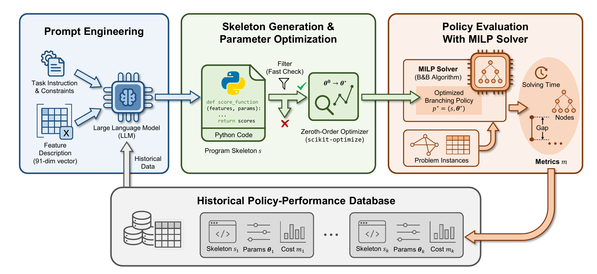

# LLM4Branch

**Official Implementation — ICML 2026**

<div align="center">

[](http://arxiv.org/pdf/2605.10401)
[](https://github.com/hzn18/LLM4Branch/stargazers)


</div>

LLM4Branch is a framework that leverages Large Language Models to automatically discover efficient branching policies for Mixed Integer Linear Programming (MILP) solvers. The discovered policy is an executable program whose skeleton is generated by an LLM and whose parameters are optimized via zeroth-order methods using end-to-end solver performance feedback. This repository is developed based on the [OpenEvolve](https://github.com/algorithmicsuperintelligence/openevolve) framework.

---

## Overview

The Branch-and-Bound (B&B) algorithm is the cornerstone of modern exact MILP solvers. Its branching policy — which determines the variable to branch on at each node — is critical to performance. LLM4Branch automates the discovery of branching policies through an evolutionary process:

1. **Program Generation**: An LLM generates Python branching programs with learnable parameter placeholders.
2. **Parameter Optimization**: Programs are optimized via Bayesian optimization using direct solver feedback (number of B&B nodes).
3. **Evolutionary Search**: The LLM iteratively refines programs based on performance, creating new variants with improved heuristics.

Unlike imitation learning methods that optimize surrogate objectives, LLM4Branch directly minimizes solver cost, achieving state-of-the-art results among CPU-based methods and remaining competitive with GPU-based approaches — all while using only **8 training instances** per benchmark.

---

## Framework



*Overview of the LLM4Branch framework. The LLM generates branching programs that are evaluated on a MILP solver. Programs that pass filtering undergo parameter optimization. The best programs serve as inspiration for subsequent LLM iterations.*

---

## Key Results

Performance on four standard MILP benchmarks (geometric mean of solving time in seconds, number of B&B nodes, and wins over total finished runs). LLM4Branch achieves state-of-the-art among CPU-based methods and remains competitive with GPU-based GNN.

| Benchmark | Method | Easy Time↓ | Easy Nodes | Easy Wins | Med Time↓ | Med Nodes | Med Wins | Hard Time↓ | Hard Nodes | Hard Wins |
|-----------|--------|-----------|-----------|----------|-----------|----------|---------|-----------|-----------|---------|
| **Setcover** | RPB | 5.67 | 55.16 | 0/80 | 53.83 | 2474.10 | 1/80 | 417.62 | 3159.86 | 0/8 |
| | GNN | 4.23 | 135.96 | 0/80 | 75.44 | 2081.28 | 0/80 | 982.84 | 75384.37 | 29/60 |
| | **LLM4Branch** | **3.21** | 166.49 | **43/80** | **37.64** | 2724.87 | **54/80** | **34.38** | 2081.29 | **30/61** |
| **Cauctions** | RPB | 2.05 | 12.47 | 0/80 | 21.59 | 1407.88 | 1/80 | 221.59 | 17125.22 | 33/80 |
| | GNN | 1.32 | 70.31 | 6/80 | 17.78 | 1293.94 | 0/80 | 229.19 | 17151.55 | 22/80 |
| | **LLM4Branch** | **1.09** | 76.17 | **39/80** | **13.12** | 1647.53 | **53/80** | 244.63 | 26901.00 | **21/79** |
| **Facilities** | RPB | 42.07 | 68.20 | 1/80 | 181.47 | 148.27 | 0/80 | 674.82 | 182.23 | 2/80 |
| | GNN | 37.32 | 196.32 | 13/80 | 139.85 | 342.93 | 6/80 | 730.12 | 444.55 | 3/78 |
| | **LLM4Branch** | **30.07** | 234.73 | **36/80** | **117.94** | 353.36 | **36/80** | **512.31** | 405.74 | **30/80** |
| **Indset** | RPB | 24.48 | 495.27 | 1/80 | 146.77 | 5551.77 | 5/80 | 2344.12 | 65811.41 | 1/27 |
| | GNN | 13.60 | 379.97 | 12/80 | 118.63 | 4864.39 | 4/75 | 2823.84 | 75748.50 | 0/15 |
| | **LLM4Branch** | **10.91** | 453.86 | **42/80** | **62.45** | 3276.22 | **66/80** | **1512.33** | 68606.59 | **38/39** |

---

## Repository Structure

```
.
├── openevolve/                 # Core framework
│   ├── controller.py           # Main evolution orchestrator
│   ├── database.py             # MAP-Elites with island-based evolution
│   ├── evaluator.py            # Cascade evaluation pipeline
│   ├── iteration.py            # Worker process for evolution iterations
│   └── llm/                    # LLM integration (ensemble, async, retry)
├── examples/
│   └── brancher/               # Branching policy discovery example
│       ├── initial_program.py  # Initial branching program template
│       ├── evaluator.py        # Evaluator for branching policies
│       ├── generator.py        # Problem instance generator
│       ├── config.yaml         # Evolution configuration
│       ├── evaluator_config.yaml
│       ├── scripts/
│       │   ├── run.sh          # Run evolution
│       │   └── eval.sh         # Evaluate discovered policies
│       ├── program/            # Discovered policies per benchmark
│       └── output/             # Evolution outputs
├── configs/                    # Global configuration
│   ├── default_config.yaml
│   ├── key_set.yaml            # LLM API key template
│   └── island_config_example.yaml
├── openevolve-run.py           # Main entry point
└── images/                     # Paper figures
```

---

## Installation

### Prerequisites

- Python ≥ 3.10

### Setup

```bash
# Clone the repository
git clone https://github.com/hzn18/LLM4Branch.git
cd LLM4Branch

# Create conda environment (recommended)
conda create -n llm4branch python=3.10 -y
conda activate llm4branch

# Install dependencies (SCIP, etc.)
conda install -c conda-forge pyscipopt scikit-optimize psutil

# Install the package
pip install -e ".[dev]"
```

### Install Ecole

This project requires a custom fork of Ecole for feature extraction. Install it from the following repository:

```bash
git clone https://github.com/hzn18/LLM4Branch-ecole
# Intall as instruction
```

See the [Repository](https://github.com/hzn18/LLM4Branch-ecole) for detailed installation instructions and requirements.

### Configure LLM API

```bash
cp configs/key_set.yaml configs/my_key_set.yaml
# Edit my_key_set.yaml with your API keys
```

---

## Quick Start

### Run Evolution

[`examples/brancher/scripts/run.sh`](examples/brancher/scripts/run.sh) launches the evolutionary search. Key parameters configured inside the script:

- **EVAL_CONFIG**: path to the evaluator configuration file (evaluator thresholds and budgets)
- **CONFIG**: path to the main evolution configuration (LLM model, iterations, population size)
- **INITIAL_PROGRAM**: the initial branching policy template used as the starting point

```bash
bash examples/brancher/scripts/run.sh
```

This will:
1. Start with the initial branching program
2. Run 200 evolutionary iterations using the LLM
3. Store discovered policies in the database
4. Save checkpoints periodically

### Evaluate Discovered Policies

[`examples/brancher/scripts/eval.sh`](examples/brancher/scripts/eval.sh) evaluates the final discovered policy on test instances and reports metrics (solving time, B&B nodes, wins). A parallel version [`examples/brancher/scripts/eval-parallel.sh`](examples/brancher/scripts/eval-parallel.sh) is also available for evaluating multiple policies concurrently across instances.

```bash
# Sequential evaluation
bash examples/brancher/scripts/eval.sh

# Parallel evaluation (faster for large test sets)
bash examples/brancher/scripts/eval-parallel.sh
```

### Custom Configuration

Edit `examples/brancher/config.yaml` to adjust:
- LLM model and parameters
- Number of iterations
- Population size and island configuration
- Evaluation budget

## Discovered Policies

LLM4Branch discovers human-readable branching policies with explicit semantics. Example from SetCover:

```python
def score_function(variable_features, params):
    centrality = 4.0 * fractional_part * (1.0 - fractional_part)
    pseudocost_strength = np.log1p(np.abs(pseudocost_product) + 1e-8)
    constraint_activity = np.tanh(dyn_degree_mean * 0.4) * np.tanh(active_constraint_count * 0.06)
    # ... combined into a final score
    return np.log1p(np.exp(raw_score - 2.0))
```

Full discovered policies for all benchmarks are in Appendix H of the paper and in [examples/brancher/program/](examples/brancher/program/).

---

## Configuration

| File | Purpose |
|------|---------|
| `configs/my_key_set.yaml` | LLM API keys (user-specific) |
| `examples/brancher/config.yaml` | Branching experiment config |
| `examples/brancher/evaluator_config.yaml` | Evaluator thresholds and budgets |

Key configuration options:
- **LLM**: model name, temperature, max tokens
- **Evolution**: mutation rate, population size, iterations
- **Islands**: number of islands, migration frequency, topology
- **Evaluation**: instance sets, time limits, performance thresholds

---

## Citation

If you find this work useful in your research, please cite:

```bibtex
@misc{hou2026llm4branchlargelanguagemodel,
      title={LLM4Branch: Large Language Model for Discovering Efficient Branching Policies of Integer Programs}, 
      author={Zhinan Hou and Xingchen Li and Yankai Zhang and Tianxun Li and Keyou You},
      year={2026},
      eprint={2605.10401},
      archivePrefix={arXiv},
      primaryClass={cs.AI},
      url={https://arxiv.org/abs/2605.10401}, 
}
```

---

## License

This project is licensed under the terms of the [LICENSE](LICENSE) file.

## Contact

For questions or issues, please open a GitHub issue or contact the repository maintainer.
